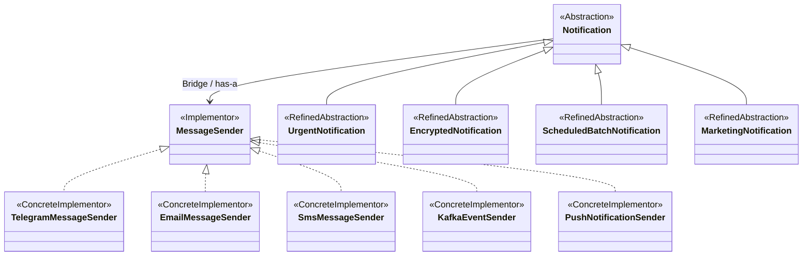

# Multi-Channel Notification Gateway

Assignment 3 — Software Design Patterns. Java 17+, Bridge, simulated providers.

## Run

Open this folder as a Maven project in IntelliJ IDEA, select **JDK 17 or newer**, and run `gateway.Main`.
Run `GatewayTest` to execute the JUnit tests. Maven dependencies require internet on first import.

With JDK 17+ and Maven installed:

```bash
mvn test
mvn compile exec:java
```

To run only the application without Maven (from the project root):

```bash
javac -encoding UTF-8 -d out src/main/java/gateway/*.java
java -cp out gateway.Main
```

All channels print simulated messages. No accounts, credentials, APIs, database or framework are needed.

## Structure and requirements

All classes are in `src/main/java/gateway`; tests are in `src/test/java/gateway/GatewayTest.java`.

| Requirement | Implementation |
| --- | --- |
| Implementor | `MessageSender` with the three required methods |
| Abstraction and runtime switching | `Notification`, protected `sender`, `setSender` |
| Urgent message and fallback | `UrgentNotification`, `[URGENT]`, availability check, optional fallback |
| Message transformation | `EncryptedNotification`, UTF-8 Base64 |
| Multiple recipients and summary | `ScheduledBatchNotification`, `addRecipient`, `sendBatch` |
| Original providers | `TelegramMessageSender`, `EmailMessageSender`, `SmsMessageSender`, `KafkaEventSender` |
| Independent extensions | `PushNotificationSender`, `MarketingNotification` |
| Demo | `Main`, all six required scenarios plus Kafka |
| Tests | 12 JUnit 5 tests |

Provider differences: Telegram uses Markdown-style bold titles; Email includes a subject and signature; SMS sends only the body and rejects bodies longer than 160 Java characters (`String.length()`); Kafka prints an event with topic, key and value; Push prints a device notification.
Each sender has a default available constructor and a boolean constructor to simulate downtime.
Empty recipients and null bodies fail. Recipient formats are not validated in this simulation.

Urgent tries fallback if the primary is unavailable **or** returns false. If both fail, it prints `Urgent: failed`. No provider-specific checks or `instanceof` are used.
Base64 is an assignment-approved transformation, **not secure encryption**.
The batch executes when called; a timer or background scheduler is not required by the listed minimum requirements. `send(recipient, message)` delegates to the stored recipient collection and ignores the single recipient argument. Prefer `sendBatch(message)` for clarity.

## UML class diagram

GitHub renders the Mermaid diagram below. Labels identify the Bridge roles; the `sender` association is the Bridge.



## Six required answers

1. **What are the two independent dimensions?** Notification behavior (urgent, encoded, batch, marketing) and delivery channel (Telegram, Email, SMS, Kafka, Push).
2. **Where exactly is the Bridge?** The `protected MessageSender sender` field in `Notification`. Subclasses delegate delivery to this interface instead of implementing a channel themselves.
3. **Why is inheritance problematic here?** Combining both dimensions in subclasses creates up to N × M combinations, such as `UrgentSmsNotification`. Bridge separates them into N notification types and M providers, connected through composition.
4. **What happens when a new provider is added?** Implement `MessageSender`, then pass the new object to any notification constructor or `setSender`. Existing notification classes do not change. `PushNotificationSender` demonstrates this.
5. **What happens when a new notification type is added?** Extend `Notification`, prepare its message, and call `sender.sendMessage`. Existing senders do not change. `MarketingNotification` demonstrates this.
6. **Why Bridge rather than Adapter?** We deliberately separate two independently extensible dimensions. We are not wrapping an incompatible legacy API to match another interface, which would be Adapter's purpose.

## Demo

`Main` labels these scenarios:

1. Urgent + Telegram: prints a formatted `[URGENT]` message.
2. Encrypted + Email: prints Base64 in the email body.
3. Batch + SMS: two valid recipients and one blank recipient; summary is Total: 3, Successful: 2, Failed: 1.
4. Runtime switch: the **same** urgent object from scenario 1 uses `setSender(email)`.
5. Unavailable Telegram: switches to the SMS fallback.
6. Marketing + Push: prints `[PROMO] 20% discount today`.
7. Additional Kafka example: prints a simulated event.

## Tests

The 12 tests verify formatted Telegram delivery, unavailable provider rejection, fallback, SMS 160/161 boundary, Base64 transformation, mixed batch outcomes, runtime switching, Push with an existing notification, Marketing with an existing provider, both providers unavailable, no fallback after primary success, and Kafka event output.
Tests use real providers and a small recording implementation of `MessageSender`; no Mockito is needed.

